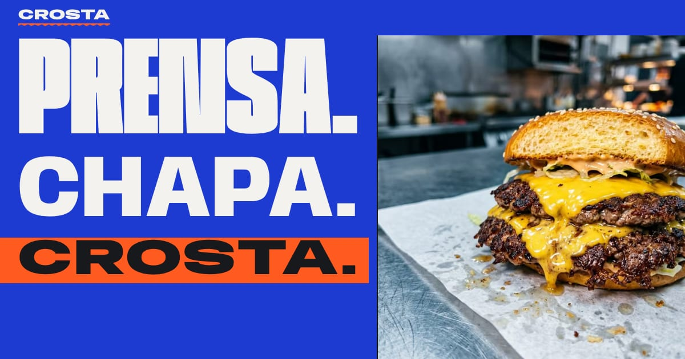

# Crosta — smash burgers

Projeto conceitual de portfólio: site de cardápio e pedido para uma hamburgueria fictícia de smash burger. Você monta o burger camada por camada, acompanha tudo numa comanda de papel térmico e fecha o pedido pelo WhatsApp, para entrega ou retirada no balcão.

> Marca, endereço, bairros, preços e campanha são fictícios. Nenhum pedido é processado de verdade.



## Direção de arte

A tese, a decisão arriscada, a paleta, a tipografia, a assinatura e as proibições estão em [`docs/DIRECAO.md`](docs/DIRECAO.md). Resumo:

- **Tese:** smash burger é um gesto. Bola de carne, chapa a 230 °C e espátula; a borda rendada vira a crosta. O site funciona como um balcão, e tudo que importa sai impresso na comanda.
- **Cor:** azul cobalto (`#1D3BD1`) como cor da marca, numa categoria tomada por vermelho e amarelo. É a cor da caneta de comanda e complementa o laranja da crosta. Laranja chapa (`#FF5A1F`) é sempre ação, com texto grafite.
- **Tipografia:** Anybody, com o eixo de largura como voz da marca: condensada para a bola de carne, larga para a carne prensada. Archivo para leitura e Martian Mono para a impressão térmica.
- **Materiais:** aço escovado (trilho e superfícies), papel térmico (comanda e etiquetas), tinta de carimbo.

### As duas assinaturas

1. **Monte seu smash.** Ficha técnica com vista explodida do burger desenhada em SVG. Cada camada cai na pilha ao ser escolhida e mostra legenda e preço. Ingrediente retirado aparece tracejado e riscado. No celular, a pilha encolhe numa faixa presa no topo enquanto as escolhas rolam.
2. **A comanda.** Papel térmico pendurado num trilho de inox (desktop) ou preso no rodapé (celular). Os itens ficam agrupados por estação da cozinha (chapa, fritadeira, balcão), com modificadores, picote e totais. Cada item novo é "impresso" de cima para baixo, em passos de cabeça térmica. O checkout acontece dentro do próprio papel.

## O que funciona

- **Cardápio:** 16 produtos em 5 categorias, com densidades diferentes. Há destaque editorial, linhas com foto, bandeja de combo, batata só tipográfica e uma tabela grafite para bebidas e sobremesas.
- **Personalização sem nada pré-selecionado:**
  - ponto da carne obrigatório;
  - retirar ingredientes;
  - extras com limite próprio e limites somados (até 2 molhos, até 4 queijos, até 4 carnes por pão);
  - quantidade de 1 a 10 e observação de até 140 caracteres.
- **Comanda:**
  - adicionar, mudar a quantidade, editar a linha (reabre com as escolhas) e tirar com "desfazer";
  - linhas iguais se somam;
  - persistência em `localStorage` versionado. O preço nunca é lido do storage: é recalculado a partir do cardápio, e o que saiu do cardápio é descartado.
- **Horário real em `America/Sao_Paulo`:**
  - expediente que atravessa a meia-noite;
  - pedidos "para agora" até 15 min antes de fechar;
  - com a loja fechada, só dá para agendar (até 6 dias à frente, de 15 em 15 min, e a confirmação depende da loja);
  - retirada (antecedência de 20 min) e entrega (45 min) têm horários e textos diferentes.
- **Entrega:** 7 bairros com taxa e tempo próprios, pedido mínimo de R$ 40 em itens, endereço com validação e mensagens claras. Sem autocompletar endereço nem CEP.
- **Pagamento:** Pix (chave na confirmação), dinheiro com troco validado contra o total, ou cartão na entrega ou retirada. Nada é cobrado pelo site.
- **WhatsApp:** mensagem completa e legível, com itens, modificadores, valores, cupom, endereço ou retirada, horário, pagamento, troco e nome, codificada com `encodeURIComponent`. Sem número configurado, a mensagem aparece para copiar.
- **Campanha "Dupla da Chapa":** R$ 49 em vez de R$ 64 às terças e quartas, contando pelo dia do serviço (inclusive depois da meia-noite e em pedidos agendados), até 2 por pedido.
- **Cupom de demonstração `BALCAO10`:** 10% nos itens fora da campanha, a partir de R$ 70, com desconto máximo de R$ 15. Avisa quando é inválido e quanto falta para o mínimo.
- **Estados cobertos:** carregando, vazio, erro, item indisponível, loja fechada, cozinha fechando, cupom inválido e pedido mínimo não atingido.

### Componentes próprios

Nenhum controle tem cara de padrão do navegador:

- grupo de escolha (com setas do teclado);
- contador;
- campo de linha;
- seletor de bairro com lista;
- diálogo com Esc, foco preso e devolvido, e pilha para diálogos aninhados;
- caixa de seleção.

Todos os campos usam `autocomplete="off"` e nomes não reconhecíveis por gerenciadores de senha. O navegador pode ignorar esse pedido em alguns casos.

## Arquitetura

```
src/
  data/       cardápio, loja (horário, bairros, mínimo), campanha e cupom, fotos
  lib/        regras puras, sem React:
              money (centavos), hours (fuso de Brasília), order (configuração,
              validação, camadas do desenho), pricing, checkout, message (WhatsApp)
  components/ BurgerStack (SVG), Customizer, ProductDialog,
              comanda/ (Ticket, Checkout, Sent, Rail, MobileBar), sections/, ui/
```

Tecnologias:

- Next.js 16 (App Router, página estática);
- React 19 e TypeScript;
- Tailwind CSS 4 com tema próprio;
- `next/image` (AVIF e WebP);
- `next/font`;
- nenhuma biblioteca de animação.

## Rodando

```bash
npm install
npm run dev          # http://localhost:3000
npm run build && npm start
```

Variáveis opcionais (`.env.local`):

```
NEXT_PUBLIC_WHATSAPP_NUMBER=55DDNUMERO   # sem número, o site mostra a mensagem para copiar
NEXT_PUBLIC_SITE_URL=https://seu-dominio
```

## Testes e validação

| Verificação | Resultado |
| --- | --- |
| `npm test`: regras de negócio (horário depois da meia-noite, agenda, campanha, cupom, taxa, mínimo, troco, mensagem e URL do WhatsApp) | 9 de 9 |
| `npm run test:e2e`: fluxos no navegador com relógio fixo (loja aberta e fechada) em 1440, 390 e 320 px | 68 de 68 |
| `npm run lint` e `npm run typecheck` | sem erros |
| Lighthouse desktop | 99 · 100 · 100 · 100 |
| Lighthouse celular | 88 · 100 · 100 · 100 |
| Rolagem horizontal em 320, 390, 768, 1024 e 1440 px | nenhuma |

Os testes de fluxo cobrem:

- obrigatórios sem pré-seleção;
- Esc e devolução de foco;
- preço com extras;
- impressão na comanda;
- agrupamento por estação;
- cupom inválido e válido;
- persistência ao recarregar;
- edição de linha;
- validação do checkout;
- seletor de bairro pelo teclado;
- troco;
- texto da mensagem;
- campanha com a loja fechada;
- agendamento;
- limite de molhos;
- barra fixa que não cobre o botão;
- diálogos aninhados;
- movimento reduzido.

O e2e precisa do Playwright: `PLAYWRIGHT_PATH=... node tests/e2e.mjs` com o servidor de produção na porta 3200.

**Limite conhecido:** no Lighthouse do celular, o maior elemento é o título "Prensa." e ele espera a fonte variável carregar (LCP de cerca de 3,6 s na simulação de 4G lento). Trocar a fonte por uma do sistema resolveria a métrica, mas desmontaria a identidade. Preferi manter a fonte.

## Autoavaliação

| Critério | Nota | O que segurou / o que foi corrigido |
| --- | --- | --- |
| Identidade sem logo | 5 | Cobalto + laranja, largura variável da Anybody e papel térmico se reconhecem sem a marca. |
| Coerência | 4 | Aço, papel e tinta aparecem com função. As fotos vêm de duas fontes e foram escolhidas pela mesma luz de bancada de inox. |
| Hierarquia | 4 | O preço é sempre mono e na mesma posição. O título do herói foi calibrado por largura de contêiner para cada linha ocupar a coluna inteira. |
| Originalidade estrutural | 4 | Trilho de comanda fixo, ficha técnica explodida e cardápio em densidades diferentes, em vez de grade de cards. |
| Refinamento | 4 | **Corrigido:** as texturas feitas com gradientes de 1 px travavam a pintura (TBT de 440 ms); viraram ladrilhos SVG (20 ms). Também o título "Crosta" estourando em 390 px, a etiqueta de status cobrindo o texto e a barra fixa cobrindo o botão do herói em 1024 px. |
| Qualidade funcional | 5 | **Corrigido:** diálogos aninhados destravavam a rolagem (agora usam pilha); a lista de bairros pulava uma opção quando o mouse estava parado sobre ela; "2x" ficava colado no nome para leitores de tela. |
| Responsividade e acessibilidade | 4 | **Corrigido:** os botões de sabor e tamanho tinham nome acessível diferente do texto visível. A nota de desempenho no celular é a ressalva. |

## Créditos

Fotos da chapa, do shake e do brownie: Edward Howell, Honney Artkongharn, Jacob Lo e Pushpak Dsilva, via [Unsplash](https://unsplash.com).

Design e código: [Saymon Oliveira](https://saymonthedev.com).
